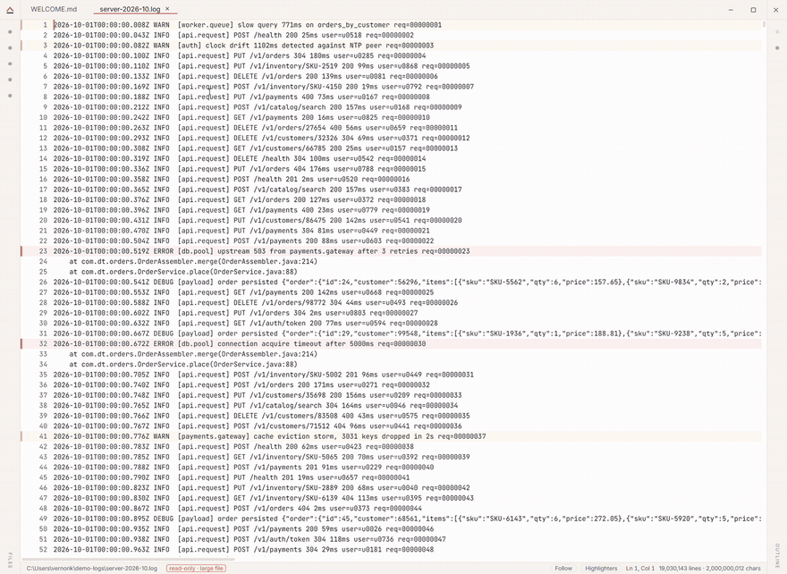

# tuhi

**A fast, cross-platform text & Markdown editor that opens multi-GB files.** Built in
Rust + Tauri: small native binaries, no Electron weight, and the loved parts of
Notepad++ rebuilt portable and modern, without becoming an IDE or a knowledge-base.

> **tuhi** is te reo Māori for *to write, to inscribe, to record*.

## Highlights

- **Huge files, no cliff.** Open and scroll multi-GB logs and data dumps with flat
  memory. Files 25 MB and up use a read-only memory-mapped engine; nothing has to load
  the whole file into the view.
- **Markdown that edits in place.** A `.md` opens rendered by default; click any block to
  edit just that block as raw Markdown, then click away and it re-renders — no separate
  preview pane. Tables, syntax-highlighted code, Mermaid diagrams and KaTeX math, with the
  source always a keystroke away. Your files stay plain `.md`, no vault or lock-in.
- **Live filter-to-view.** Type a regex and the document collapses to just the matching
  lines, instantly, over any size, non-destructive.
- **Follow / tail + highlighters.** Follow a growing file as it's written, with saved
  pattern→colour rules (ERROR red, WARN amber).
- **One-key pretty-print.** Open a minified JSON blob that freezes other editors and
  reflow it with a keystroke.
- **A real editor underneath.** Tabs, undo/redo, find & replace (regex), syntax
  highlighting, a file tree, a collapsible outline, a command palette, session restore.
- **Safe by default.** Crash-safe: unsaved changes are journalled as you type and offered
  back if the app is killed. Atomic save (a failed write can't destroy your file),
  encoding detection (UTF-8/BOM, UTF-16, Latin-1), and an "open as text?" guard so a
  binary file never renders as garbage.

## Demo



A real 2 GB server log (19 million lines) opens instantly through the read-only
memory-mapped engine, then one regex in the filter collapses the whole file to just the
matching lines — the file never loads into the view, and memory stays flat throughout.

## How it works

Two buffer strategies, chosen by file size. Files under 25 MB load into an in-memory rope
— fast edits anywhere, unlimited undo. Files 25 MB and up open through a read-only
memory-mapped engine: the OS pages the file in on demand, so opening a 3 GB log is
near-instant and memory stays flat, because the view only ever holds the lines actually on
screen. Rendering is virtualised (only visible rows exist in the DOM) and syntax
highlighting runs off the UI thread, so scrolling a huge file never blocks. It's built on
Tauri — a Rust core with the system WebView — so the binaries are small and native, with
no bundled browser.

## Install

Grab the installer for your OS from the [latest release](../../releases/latest):

- **Windows** — `.msi` or `.exe`
- **macOS** — `.dmg` (universal: Apple Silicon + Intel)
- **Linux** — `.AppImage`, `.deb`, or `.rpm`

**First-launch note (unsigned builds).** v1.0 ships unsigned, so your OS will warn
once:

- **Windows:** SmartScreen says "Windows protected your PC" → **More info** → **Run
  anyway**.
- **macOS:** Gatekeeper says the developer can't be verified → right-click the app →
  **Open** (or allow it in System Settings → Privacy & Security).

Signing is on the roadmap once there's traction.

## Build from source

Needs [Rust](https://rustup.rs), Node 20+, and the Tauri prerequisites for your OS.

```sh
just setup     # install git hooks + frontend deps
just dev       # run with hot reload
just build     # a release bundle for your OS
```

No `just`? The recipes just wrap `npm` in `app/` (`cd app && npm install`, then
`npm run tauri dev` / `npm run tauri build`).

## Status & roadmap

**v1.0 is here.** Large-file handling, Markdown mode (preview, edit-in-place,
tables/code/Mermaid/KaTeX) and crash-safe editing are all shipped. On the roadmap:
signed/notarised builds, editable large files, an Android build, and ongoing polish, on
the [public roadmap board][board] and in [`ROADMAP.md`](ROADMAP.md). Ideas and bugs are
very welcome, come to [Discussions][discussions] for ideas and questions, or open an
[issue][issues].

[board]: https://github.com/users/vernonkay/projects/1
[discussions]: https://github.com/vernonkay/tuhi/discussions
[issues]: https://github.com/vernonkay/tuhi/issues

## Contributing

Issues and PRs welcome. See [`CONTRIBUTING.md`](CONTRIBUTING.md),
[`CODE_OF_CONDUCT.md`](CODE_OF_CONDUCT.md), and [`SECURITY.md`](SECURITY.md).

## Licence

Dual-licensed under **MIT OR Apache-2.0**, at your option, the Rust-ecosystem norm. See
[`LICENSE-MIT`](LICENSE-MIT) and [`LICENSE-APACHE`](LICENSE-APACHE).

## Built with AI assistance

tuhi is built by Vernon Kay with heavy use of AI assistance (Claude Code). The code, the
decisions and the responsibility are the author's; the AI is a tool, disclosed here
rather than credited per commit.
