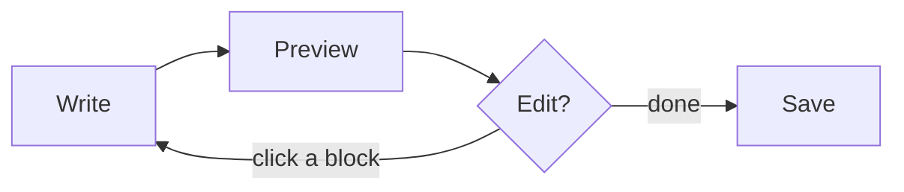

# Welcome to tuhi

**tuhi** is a fast, calm text and Markdown editor that isn't afraid of big files. This
document is written in Markdown — you're reading it rendered. Click any block to edit it
in place, or press the **Source** dot on the right rail to see the raw text.

> **tuhi** is te reo Māori for *to write, to inscribe, to record*.

## Big files, no cliff

The thing tuhi does that most editors won't: open a multi-gigabyte log or data dump and
scroll it instantly, with flat memory. Files 25 MB and up open on a read-only
memory-mapped engine, so nothing has to load the whole file into the view.

Over any size, you can:

- **Filter to view** — type a regex and the document collapses to just the matching lines.
- **Follow / tail** — watch a growing file as it's written, with saved pattern→colour
  rules (`ERROR` red, `WARN` amber).
- **Find and go-to-line** at GB scale, not just scrolling.
- **Pretty-print** a minified JSON blob that freezes other editors, with one keystroke.

## Markdown that edits in place

Open a `.md` and tuhi shows it rendered by default. There's no separate preview pane to
keep in sync — the document *is* the editor. Click a paragraph, a heading, a list, and
that one block opens as raw Markdown; edit it, click away, and it re-renders. Press the
**Source** dot any time to drop the whole document to raw text.

It renders the things you'd want:

### Tables

| Feature | Status | Notes |
|:--------|:------:|:------|
| Preview | ✅ | rendered by default |
| Edit in place | ✅ | click a block |
| Big files | ✅ | virtualized, scales |

### Code, highlighted

```rust
fn main() {
    let greeting = "kia ora, world";
    println!("{greeting}");
}
```

### Diagrams, with Mermaid



### Math, with KaTeX

Inline, like $E = mc^2$, or set apart on its own line:

$$\int_{-\infty}^{\infty} e^{-x^2}\,dx = \sqrt{\pi}$$

Your files stay plain `.md` and `.txt` on disk the whole time — no vault, no lock-in, no
proprietary format.

## A real editor underneath

Tabs, undo/redo, find & replace with regex, syntax highlighting, a file tree, a
collapsible outline, a command palette, and session restore. Plus:

- **Crash-safe.** Unsaved changes are journalled as you type, so if the power goes out or
  the app is killed, your work is offered back next time you open tuhi.
- **Safe saves.** Writes are atomic — a failed save can never destroy your file — and
  encodings (UTF-8/BOM, UTF-16, Latin-1) are detected and preserved.
- **Opens text, not garbage.** Try to open a binary file and tuhi asks first, rather than
  filling the screen with mojibake.

## Keyboard

| Action | Shortcut |
|:-------|:---------|
| Command palette | `Ctrl/⌘ + P` |
| Open / Save | `Ctrl/⌘ + O` / `Ctrl/⌘ + S` |
| Find / Replace | `Ctrl/⌘ + F` |
| Go to line | `Ctrl/⌘ + G` |
| Word-wise move / select | `Ctrl + ←/→` (`+ Shift`) |
| Preview ↔ source (Markdown) | the **Source** dot, or the palette |

Everything is in the **command palette** (`Ctrl/⌘ + P`) if you'd rather not remember
shortcuts.

## Where next

- The project and source: <https://github.com/vernonkay/tuhi>
- What's planned: [the roadmap](https://github.com/vernonkay/tuhi/blob/main/ROADMAP.md)

Now delete all of this and start writing. Or don't — click a heading above and make it
yours. Either way, welcome. ✍️
